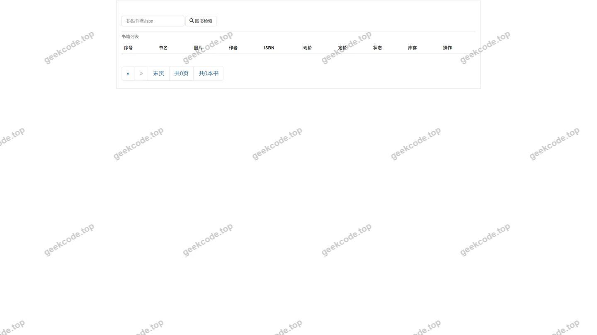
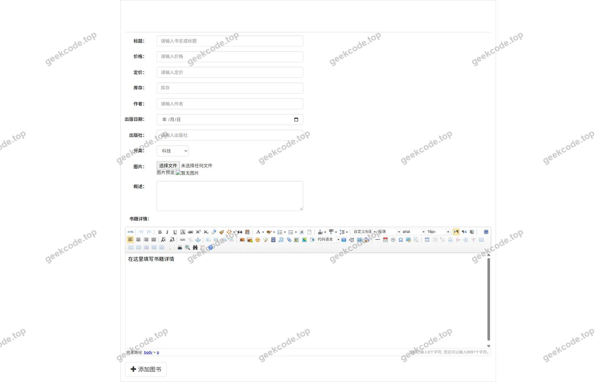
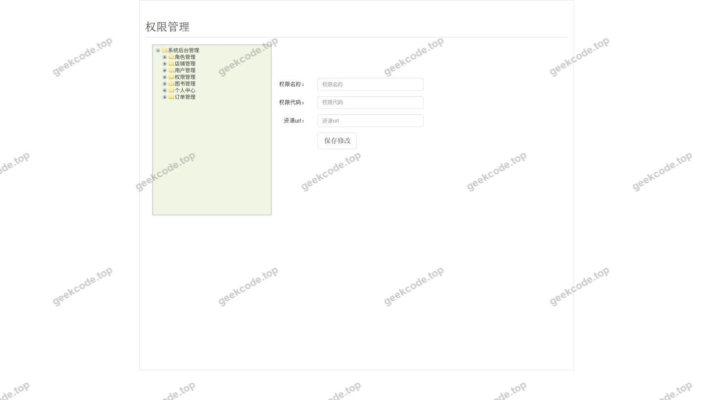
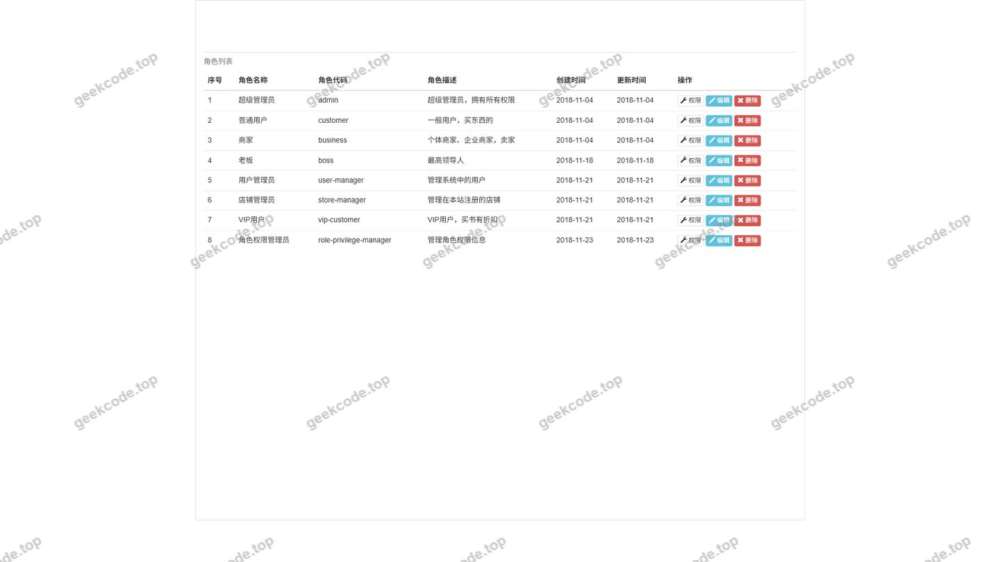
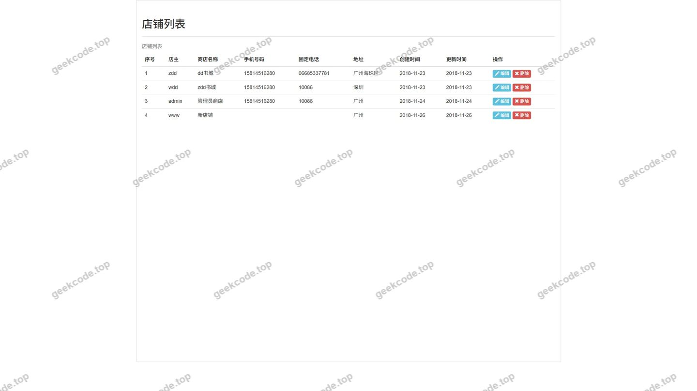
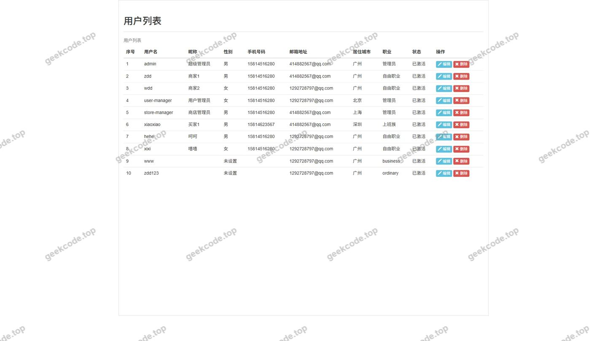

# springboot 电商书城平台系统(已调试)

> 🎓 **计算机毕业设计 · springboot 电商书城平台系统(已调试)**
>
> 本仓库只放**项目介绍 + 运行截图**（截图是站点带水印的原图，存在仓库 `images/` 里）。
>
> 👉 **完整可运行源码 / 数据库脚本 / 部署文档：[点我获取](https://geekcode.top/archives/springboot-%E7%94%B5%E5%95%86%E4%B9%A6%E5%9F%8E%E5%B9%B3%E5%8F%B0%E7%B3%BB%E7%BB%9F-%E5%B7%B2%E8%B0%83%E8%AF%95?utm_source=github)**
>
> 💬 咨询微信：**ir9372**　|　🌐 更多项目：[极客代码 geekcode.top](https://geekcode.top/?utm_source=github)
>
> 📌 项目详情页：<https://geekcode.top/archives/springboot-%E7%94%B5%E5%95%86%E4%B9%A6%E5%9F%8E%E5%B9%B3%E5%8F%B0%E7%B3%BB%E7%BB%9F-%E5%B7%B2%E8%B0%83%E8%AF%95?utm_source=github>

<table><td width="230" align="center"> <b>扫码加微信 ir9372</b></td><td valign="middle">📦 源码 = 项目介绍 + 全部运行截图 + 数据库 + 部署文档 👉 点上方任意截图，直接跳到 <b>极客代码 geekcode.top</b> 详情页</td></table>

---

<h1>springboot 电商书城平台系统(已调试)</h1>
<h2>项目概述</h2>

本项目名为“电商书城平台系统”，旨在构建一个基于 Web 的图书销售与管理平台。尽管项目元数据中未明确标注前后台界面，但根据截图中的“登录”、“列表”、“添加（toAddition）”及“科技”分类页面推断，系统具备基本的用户交互与数据管理能力。核心功能涵盖用户身份验证、图书信息浏览、分类展示（如科技类）、以及图书数据的增删改查管理。该系统适用于中小型在线书店或校园内部资料流通场景，主要面向管理员进行图书库存维护，以及普通用户进行图书查询与购买意向操作。技术架构采用经典的 MVC 模式，后端基于 Spring Boot 框架提供 RESTful 或传统 Servlet 服务，持久层使用 MyBatis 处理数据库交互，安全认证模块集成 Apache Shiro，前端视图层依托 JSP 技术实现动态渲染。

<h2>技术架构</h2>

本系统采用分层架构设计，确保代码的可维护性与扩展性。

<strong>1. 后端架构：</strong>

<ul>
<li><strong>基础框架</strong>：选用 <code>Spring Boot</code> 作为核心容器，利用其自动配置特性快速搭建应用骨架。依赖 <code>spring-boot-starter-web</code> 提供 Web 服务能力，<code>spring-boot-devtools</code> 用于开发阶段的快速热部署。</li>
<li><strong>持久层</strong>：采用 <code>MyBatis</code> 结合 <code>mapper-spring-boot-starter</code> 和通用 Mapper (<code>tk.mybatis</code>) 简化单表 CRUD 操作。分页功能通过 <code>pagehelper-spring-boot-starter</code> 实现，优化大数据量下的列表加载性能。</li>
<li><strong>安全层</strong>：集成 <code>Apache Shiro</code> 进行权限控制与会话管理，保障系统访问安全性。</li>
<li><strong>数据库连接</strong>：使用 <code>mysql-connector-java</code> 驱动连接 MySQL 数据库。</li>
</ul>

<strong>2. 前端架构：</strong>

<ul>
<li><strong>视图技术</strong>：项目类型标记为 <code>jsp</code>，表明前端页面主要由 Java Server Pages 生成。依赖 <code>jstl</code> (JSP Standard Tag Library) 标签库简化页面逻辑判断与迭代输出。</li>
<li><strong>服务器容器</strong>：内置 <code>tomcat</code> (<code>spring-boot-starter-tomcat</code>) 作为 Servlet 容器运行 JSP 页面。</li>
</ul>

<strong>3. 数据库设计要点：</strong>
虽然具体表结构未在上下文中给出，但基于“电商书城”与“列表/添加”功能，核心实体至少包含：

<ul>
<li><strong>用户表</strong>：存储账号、密码哈希、角色标识等，供 Shiro 认证使用。</li>
<li><strong>图书表</strong>：存储书名、ISBN、价格、分类（如“科技”）、库存量、描述等信息。</li>
<li><strong>订单/交易表</strong>（推测）：若涉及电商属性，需存在关联用户与图书的交易记录表。</li>
</ul>
<h2>功能模块</h2>

根据提供的截图功能列表与路由信息缺失的情况，以下模块划分严格基于可见页面行为推导：

<strong>1. 身份认证模块</strong>

<ul>
<li><strong>用户登录</strong>：对应“页面-登录”。提供用户名与密码输入接口，经由 Shiro 过滤器进行合法性校验，成功后建立会话并跳转至主业务页面。</li>
</ul>

<strong>2. 图书展示与检索模块</strong>

<ul>
<li><strong>图书列表浏览</strong>：对应多个“页面-列表”。展示图书的基本信息，支持分页显示。可能包含搜索过滤功能，允许用户按关键词查找图书。</li>
<li><strong>分类展示</strong>：对应“页面-科技”。表明系统支持按图书类别（如科技、文学等）进行筛选或独立页面展示，方便用户定向浏览特定领域的书籍。</li>
</ul>

<strong>3. 图书管理模块</strong>

<ul>
<li><strong>新增图书</strong>：对应“页面-toAddition”。提供表单界面，允许管理员录入新书籍的信息（名称、作者、价格、分类等），提交后写入数据库。此功能通常受权限保护，仅管理员可访问。</li>
</ul>

<strong>4. 其他辅助功能</strong>

<ul>
<li><strong>个人中心/设置</strong>：虽无明确菜单，但“列表”页面的多样性暗示可能存在不同维度的数据展示（如我的订单、我的收藏等），但在现有信息中无法确认为独立模块，故归入广义的列表查看功能。</li>
</ul>
<h2>用户角色与权限</h2>

由于项目元数据显示“是否有前台: 否”且“是否有后台: 否”，这通常意味着该毕设项目可能是一个单体应用，或者前后台共用一套代码库但未在配置文件中显式分离路由。然而，基于 Shiro 的安全机制和“toAddition”这种典型的管理员操作页面，我们可以推断出隐含的角色权限模型：

<strong>1. 游客/未登录用户</strong>

<ul>
<li><strong>权限范围</strong>：受限访问。</li>
<li><strong>可执行操作</strong>：通常仅能访问首页或简单的图书预览页（如果系统设计如此）。但在本截图中，所有功能似乎都位于登录后或特定路径下，因此游客可能无法直接访问“列表”或“添加”页面，需先登录。</li>
</ul>

<strong>2. 普通用户（读者）</strong>

<ul>
<li><strong>权限范围</strong>：只读与个人数据操作。</li>
<li><strong>可执行操作</strong>：</li>
<li>访问“页面-登录”进行身份验证。</li>
<li>查看“页面-列表”中的图书信息。</li>
<li>浏览“页面-科技”等分类页面。</li>
<li><em>注意</em>：普通用户通常无权访问“页面-toAddition”（新增图书），除非系统未做严格权限隔离。</li>
</ul>

<strong>3. 管理员</strong>

<ul>
<li><strong>权限范围</strong>：全权管理与数据维护。</li>
<li><strong>可执行操作</strong>：</li>
<li>拥有普通用户的所有查看权限。</li>
<li>访问“页面-toAddition”执行图书入库操作。</li>
<li>可能对“页面-列表”有编辑或删除权限（虽截图未直接显示编辑页，但“添加”的存在暗示了完整的 CRUD 生命周期）。</li>
<li>管理系统用户状态及权限分配。</li>
</ul>

<em>特别说明：由于缺乏具体的 Shiro 配置文件上下文，上述角色划分是基于电商系统常规逻辑与截图功能的合理推断。若实际代码中未区分角色，则所有登录用户均拥有同等权限。</em>

<h2>项目特色与创新点</h2>

<strong>1. 轻量级全栈整合</strong>
项目采用了 Spring Boot + MyBatis + Shiro + JSP 的经典组合。相较于纯前后端分离架构，这种混合模式在毕业设计阶段具有极高的开发效率优势。JSP 使得后端开发者可以直接通过 HTML 模板引擎渲染页面，减少了 API 定义与前端联调的成本，适合单人或小团队快速交付完整闭环系统。

<strong>2. 标准化的权限与安全体系</strong>
引入 Apache Shiro 而非简单的 Session 检查，体现了对系统安全性的重视。Shiro 提供了细粒度的权限控制能力，能够轻松实现“只有管理员才能添加图书”这类业务规则，提升了系统的规范性与安全性演示价值。

<strong>3. 高效的持久层开发体验</strong>
结合 <code>mapper-spring-boot-starter</code> (通用 Mapper) 和 <code>pagehelper</code>，极大地简化了标准 CRUD 操作和分页查询的代码量。开发者无需编写繁琐的 SQL 语句即可完成大部分数据交互，专注于业务逻辑的实现，符合现代 Java 开发的敏捷趋势。

<strong>4. 垂直领域聚焦</strong>
系统定位为“书城”，功能模块围绕图书的生命周期（展示、分类、入库）展开，逻辑清晰，数据模型相对简单，易于调试与维护，非常适合作为计算机专业本科毕业设计的基础练手项目。

<h2>部署环境</h2>

为确保系统正常运行，需准备以下软硬件环境：

<strong>1. 硬件要求</strong>

<ul>
<li>CPU：双核及以上处理器</li>
<li>内存：建议 4GB RAM 以上（以容纳 JVM 及数据库进程）</li>
<li>硬盘：至少 10GB 可用空间</li>
</ul>

<strong>2. 软件环境</strong>

<ul>
<li><strong>操作系统</strong>：Windows 10/11, Linux (CentOS/Ubuntu), 或 macOS。</li>
<li><strong>Java 开发工具包 (JDK)</strong>：推荐 JDK 8 或 JDK 11。Spring Boot 版本需与 JDK 版本兼容（根据依赖推测为 Spring Boot 2.x 系列，强烈建议 JDK 8+）。</li>
<li><strong>数据库</strong>：MySQL 5.7 或 MySQL 8.0。需预先创建对应的数据库实例及表结构。</li>
<li><strong>Web 服务器</strong>：内嵌 Tomcat（由 <code>spring-boot-starter-tomcat</code> 提供），无需单独安装外部 Tomcat。</li>
<li><strong>构建工具</strong>：Maven 3.6+ 或 Gradle（取决于项目根目录下的构建文件，通常此类项目使用 Maven）。</li>
<li><strong>浏览器</strong>：Chrome, Firefox, Edge 等主流现代浏览器，用于访问 JSP 生成的网页。</li>
</ul>

<strong>3. 配置项</strong>

<ul>
<li>需在 <code>application.properties</code> 或 <code>application.yml</code> 中配置正确的 MySQL 连接 URL、用户名和密码。</li>
<li>需配置 Shiro 的相关过滤器链规则。</li>
</ul>
<h2>五、技术特性</h2>
<ul>
<li>服务端模板渲染（JSP）</li>
<li>集成 Shiro 权限框架实现角色权限控制</li>
</ul>
<h2>六、功能模块截图</h2>
<h3>后台管理端</h3>
<h4>页面-登录</h4>

<h4>页面-科技</h4>

<h4>页面-toAddition</h4>

<h4>页面-列表</h4>

<h4>页面-列表</h4>

<h4>页面-列表</h4>

<h4>页面-列表</h4>

---

## 获取完整源码

| 项目 | 说明 |
| --- | --- |
| 项目名 | springboot 电商书城平台系统(已调试) |
| 运行截图 | 本文 7 张（站点带水印原图，仓库 `images/` 目录） |
| 完整源码 | [https://geekcode.top/archives/springboot-%E7%94%B5%E5%95%86%E4%B9%A6%E5%9F%8E%E5%B9%B3%E5%8F%B0%E7%B3%BB%E7%BB%9F-%E5%B7%B2%E8%B0%83%E8%AF%95?utm_source=github](https://geekcode.top/archives/springboot-%E7%94%B5%E5%95%86%E4%B9%A6%E5%9F%8E%E5%B9%B3%E5%8F%B0%E7%B3%BB%E7%BB%9F-%E5%B7%B2%E8%B0%83%E8%AF%95?utm_source=github) |
| 咨询微信 | **ir9372**（备注：jingpin-yuanma） |
| 更多项目 | [极客代码 geekcode.top](https://geekcode.top/?utm_source=github) |

> 需要源码、部署、改配置、跑不起来等问题，加微信 ir9372 沟通，说明项目名即可。
